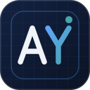
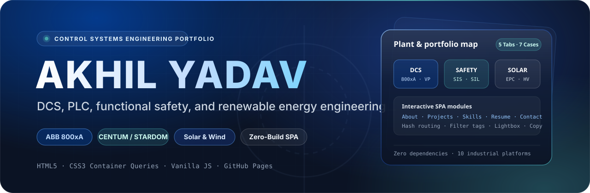
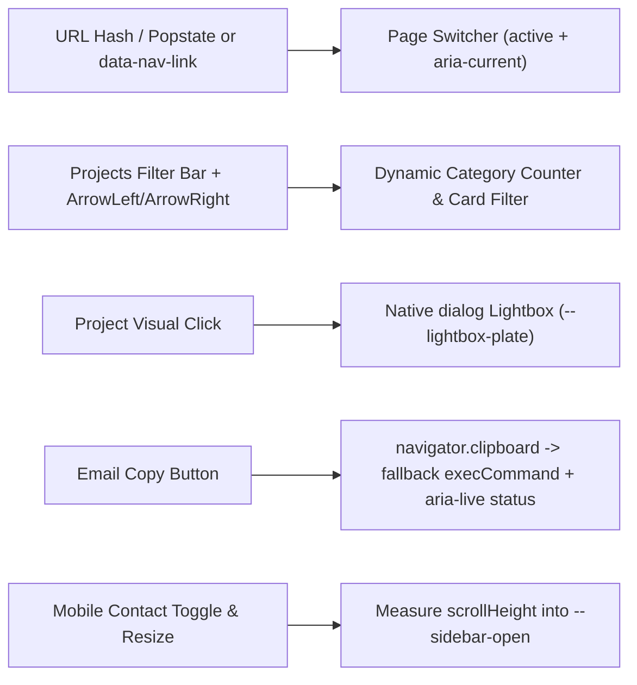

<p align="center">
  
</p>

<p align="center">
  
</p>

<p align="center">
  <a href="https://developer.mozilla.org/en-US/docs/Web/HTML"></a>
  <a href="https://developer.mozilla.org/en-US/docs/Web/CSS"></a>
  <a href="https://developer.mozilla.org/en-US/docs/Web/JavaScript"></a>
  <a href="https://pages.github.com"></a>
  <a href="LICENSE"></a>
</p>

**Akhil Yadav — Controls & Automation Portfolio** is a zero-build static single-page application built from the engineering CV in `assets/files/Akhil_Yadav_Controls_Engineer_CV.pdf`. Designed with an industrial technical console aesthetic (cool `#F0F4F9` slate backdrop, hairline cards, cobalt `#0052CC` accents, and `Manrope` + `JetBrains Mono` typography), it runs directly from plain HTML, CSS, and vanilla JavaScript with zero bundler dependencies.

---

## Contents

- [Pages and navigation](#pages-and-navigation)
- [Architecture and interactions](#architecture-and-interactions)
- [Design tokens](#design-tokens)
- [Getting started](#getting-started)
- [Authoring and customization](#authoring-and-customization)
- [Deployment](#deployment)
- [Security and repository notes](#security-and-repository-notes)
- [Credits and license](#credits-and-license)

---

## Pages and navigation

Five tabbed sections keep proof of work directly behind the engineering summary. Below `1024px`, navigation docks to the viewport bottom; from `1024px` upward, the sidebar pins as a `290px` sticky column beside top-right navigation.

| Tab | Hash | Content & structure |
| :--- | :--- | :--- |
| **About** | `#about` | Executive summary with `"let's connect"` (`data-nav-link="contact"`), six **Engineering Scope** cards, and the 10-tile **Systems & Industrial Platforms** grid (`ABB 800xA` certified banner badge plus contained `64px` logos and plate shots for CENTUM VP, STARDOM, and TwinCAT). |
| **Projects** | `#projects` | Seven single-column case studies (3 industrial controls & safety, 4 modeling & analytics) with dynamic category filters (`all`, `dcs`, `safety`, `solar`, `modelling`), `@container projects` horizontal split layout, outbound report links, and full-size `<dialog>` lightbox previews. |
| **Skills** | `#skills` | Seven grouped capability cards (`Controls & SCADA`, `Protocols & networks`, `High-voltage & plant equipment`, `Root cause & reliability`, `Software lifecycle & documentation`, `Functional safety`, blue-tinted `Tools` chips) plus Certifications and Languages. |
| **Resume** | `#resume` | Chronological Experience (`ib vogt GmbH`, `ABB`, `Yokogawa`) and Education (`TU Berlin` MBA, `Amrita` B.Tech) timelines; CV PDF download lives in the sidebar. |
| **Contact** | `#contact` | Direct cards for Email (with accessible Copy button), LinkedIn, Phone, and GitHub without any contact form backend. |

---

## Architecture and interactions

`assets/js/script.js` coordinates routing, responsive sidebar geometry, category filtering, dialog lightbox display, and clipboard fallbacks in under 170 lines without external libraries:



Under the hood:
- **History-aware tabs**: Clicking any nav button or `data-nav-link` updates `history.pushState(null, "", "#" + name)`, marks `aria-current="page"`, and handles browser back/forward via `popstate`.
- **Self-updating filter counts**: `script.js` inspects space-separated `data-category` tokens on each `<li class="work-card">` on load to compute pill counts (`7 / 2 / 2 / 1 / 4`).
- **Plate-aware lightbox**: Opening a `.work-visual-plate` image sets `--lightbox-plate` to `#FFFFFF`, while `.work-visual-cover` photography inherits its dark card frame background. `html:has(dialog[open])` locks page scroll cleanly.
- **Reduced motion**: `@media (prefers-reduced-motion: reduce)` in `assets/css/style.css` forces transitions/animations to `0.01ms` and resets `scroll-behavior: auto`.

---

## Design tokens

All visual primitives live in the `#TOKENS` section at the top of `assets/css/style.css`:

| Category | Values |
| :--- | :--- |
| **Surface & borders** | Page `#F0F4F9` with subtle 40px `--grid-line` overlay, cards `#FFFFFF`, plates `#E8EEF5`, ghost chips `#F8FAFC` on `#E2E8F0`, dividers `#D8DFE8` / `#BCC7D4`. |
| **Typography & ink** | Strong `#1E293B`, body `#475569`, muted `#64748B`; `Manrope` (`400`, `600`) across `12`–`32px` steps + `JetBrains Mono` (`400`, `600`) for industrial tags and telemetry labels. |
| **Brand accents** | Primary industrial cobalt `#0052CC`, hover/active `#2563EB`, faint tint `rgba(0, 82, 204, 0.08)`, STARDOM accent `#45A6AA`. Light color scheme only. |
| **Container breakpoints** | `@container projects (min-width: 600px)` triggers left-visual / right-copy splits (`--work-media: 260px`), widening to `300px` at container `min-width: 760px`. |

---

## Getting started

Open `index.html` directly in any modern browser, or serve locally with a static HTTP server:

```bash
python -m http.server 5173
```

Then open [http://localhost:5173](http://localhost:5173).

---

## Authoring and customization

All content lives directly in `index.html` (no JSON data file or build pipeline):

| Item | How to update |
| :--- | :--- |
| **Add a project card** | Duplicate an existing `<li class="work-card">` inside `#projects`, set space-separated `data-category` tags (`dcs`, `safety`, `solar`, `modelling`), and choose `.work-visual-cover` (full-bleed photo) or `.work-visual-plate` (80% contained diagram/logo with multiply blend on `#E8EEF5`). |
| **Headshot avatar** | Replace `assets/images/avatar.jpg` (current image is `194×194`; `300px+` square recommended for high-DPI rendering of the `150px` desktop frame). If missing or broken, `onerror="this.remove()"` reveals the crisp `"AY"` CSS monogram fallback. |
| **CV PDF** | Overwrite `assets/files/Akhil_Yadav_Controls_Engineer_CV.pdf`; the sidebar link opens and downloads the updated file automatically. |
| **Toolbox & project media** | Stored under `assets/images/toolbox/` (10 WebP files) and `assets/images/projects/` (6 WebP + 1 PNG diagram). |

---

## Deployment

Any static host serves the site as-is because every asset path uses `./assets/...` relative resolution and an empty `.nojekyll` marker bypasses Jekyll processing on GitHub Pages.

> [!NOTE]
> The repository remote is `https://github.com/akhilyad/career-portfolio.git` (which maps to GitHub Pages under `/career-portfolio/` if enabled), while `Akhil_Yadav_Controls_Engineer.md` and earlier repo notes also reference the sibling path `https://github.com/akhilyad/portfolio` (`akhilyad.github.io/portfolio/`). Cache-busting relies on standard static host headers, so CSS/JS edits may require a hard refresh on client browsers.

---

## Security and repository notes

- **Safe DOM updates & links**: `assets/js/script.js` updates text and attributes strictly via `.textContent` and `setAttribute` (no `innerHTML` writes), and external links carry `target="_blank" rel="noopener noreferrer"`.
- **Minor repo discrepancies to be aware of**:
  - `assets/images/favicon.svg` retains the legacy dark-and-gold (`#1f1f21` / `#ffdb70`) vCard favicon palette rather than the industrial cobalt palette of `assets/images/portfolio-logo.svg`.
  - The HTML **Skills** and **Resume** tabs present 7 capability cards mirroring `Engineering Scope` + `Tools`, omitting `"CDCP (in progress)"` and one pricing bullet under `ib vogt GmbH` present in `Akhil_Yadav_Controls_Engineer.md`.

---

## Credits and license

Layout and interactive structure adapted from [vCard](https://github.com/codewithsadee/vcard-personal-portfolio) by codewithsadee under the MIT License (see `LICENSE`). All personal CV content, engineering case studies, and custom diagrams belong to Akhil Yadav and are not covered by that template license.

---

<p align="center">
  <sub>Akhil Yadav · Controls &amp; Automation Portfolio · Zero-Build Static SPA</sub>
</p>
